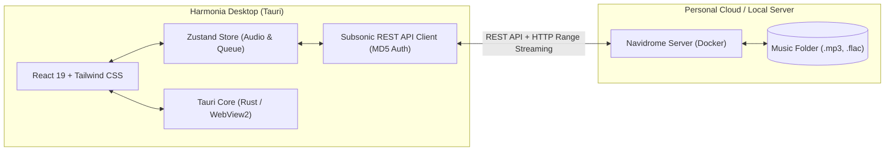

# Harmonia

<div align="center">

**A fast, modern, and open-source desktop music player inspired by Spotify.**  
Built with **Tauri v2**, **React 19**, **TypeScript**, and **Tailwind CSS**. Powered by the **Subsonic & Navidrome** standard.

[](https://opensource.org/licenses/MIT)
[](https://tauri.app)
[](https://react.dev)
[](https://tailwindcss.com)
[](https://www.navidrome.org)

</div>

---

## ✨ Features

- 🎧 **Spotify-inspired UX:** Dark sleek theme, responsive sidebar, navigation history, and persistent bottom player.
- ⚡ **Ultra-lightweight:** Consumes **~35 MB of RAM** and weighs ~12 MB (unlike traditional 500 MB Electron apps).
- 🌐 **Subsonic / Navidrome Standard:** Seamlessly connects to any Subsonic-compatible server (Navidrome, Jellyfin, Airsonic) with full streaming support.
- 🐳 **Docker-ready Backend:** Includes a 1-command Docker Compose setup to host your personal music library in seconds.
- 🚀 **Offline & Demo Mode:** Works out of the box with royalty-free tracks for testing without requiring a server setup.
- 🛡️ **Zero Telemetry & 100% Free:** No tracking, no ads, no cloud vendor lock-in.

---

## 🏗️ Architecture



---

## 🚀 Quick Start

### 1. Run the Desktop Client

Clone the repository and install dependencies:

```bash
# Install dependencies
npm install

# Run in Web Mode (Fast browser development with Hot Reload)
npm run dev

# Run in Desktop Mode (Native Windows executable with Tauri)
npm run tauri dev
```

### 2. Launch your Personal Music Server (Navidrome with Docker)

Place your music files (`.mp3`, `.flac`, `.m4a`) in `docker/music/`, then start the server:

```bash
cd docker
docker compose up -d
```

1. Open **http://localhost:4533** in your browser to create your initial admin account.
2. In **Harmonia**, click **Configurar Servidor** (top right) and enter your server URL and credentials.

---

## 📦 Building for Production

To compile the standalone Windows executable (`.exe`) and installer (`.msi`):

```bash
npm run tauri build
```

---

## 📄 License

This project is open-source under the [MIT License](LICENSE).
# Carlos-jim
